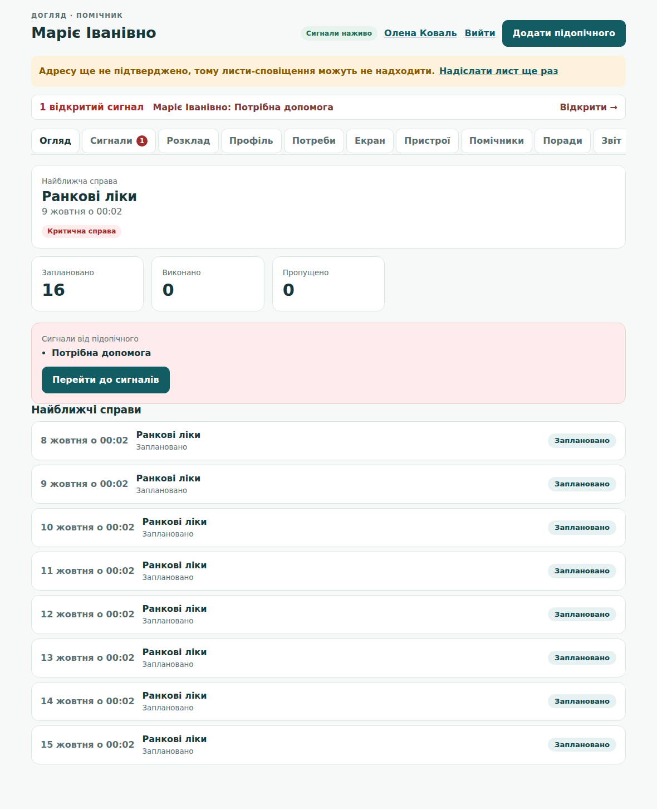
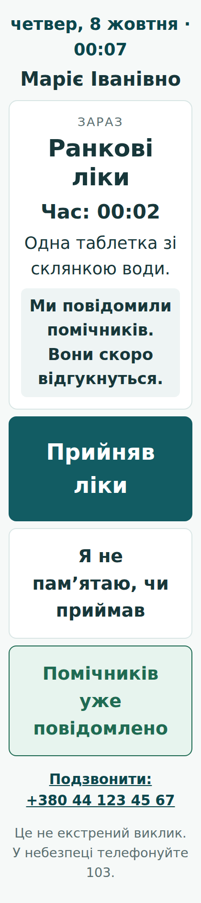
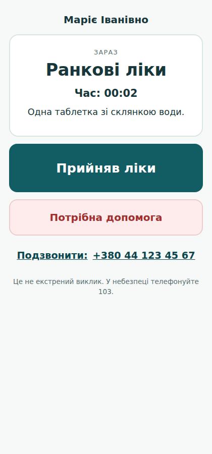
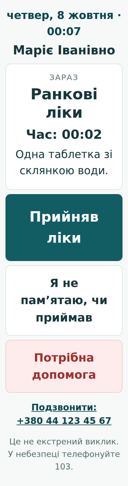
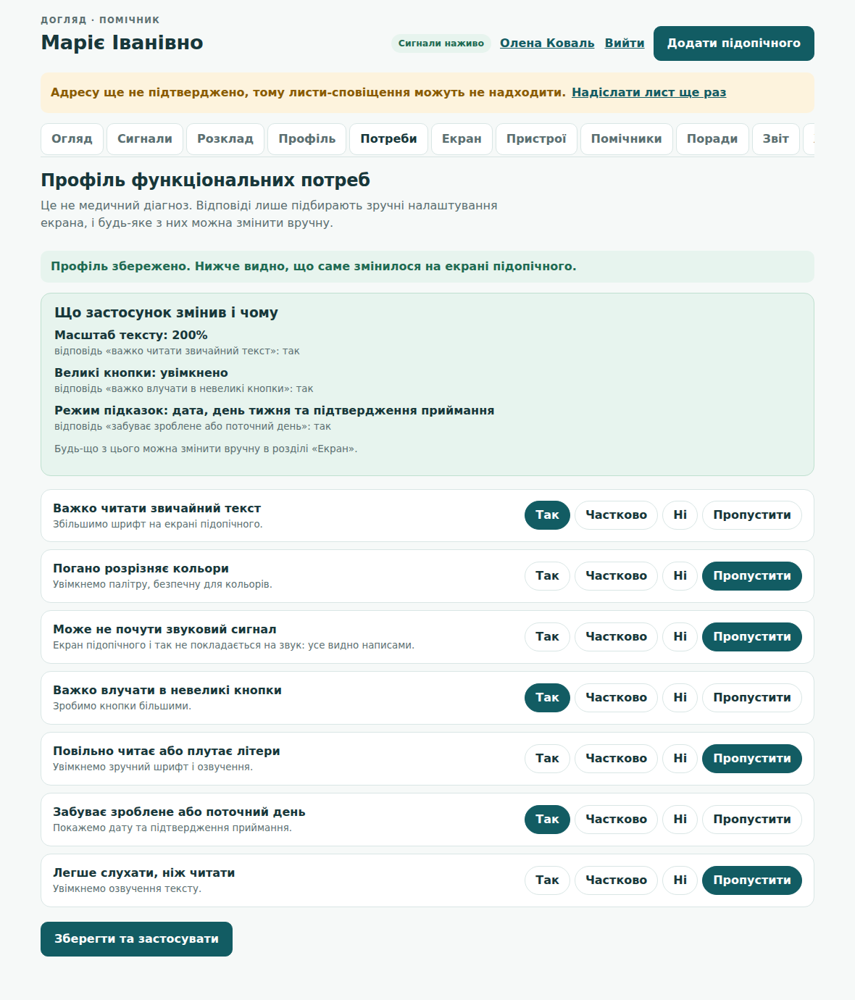
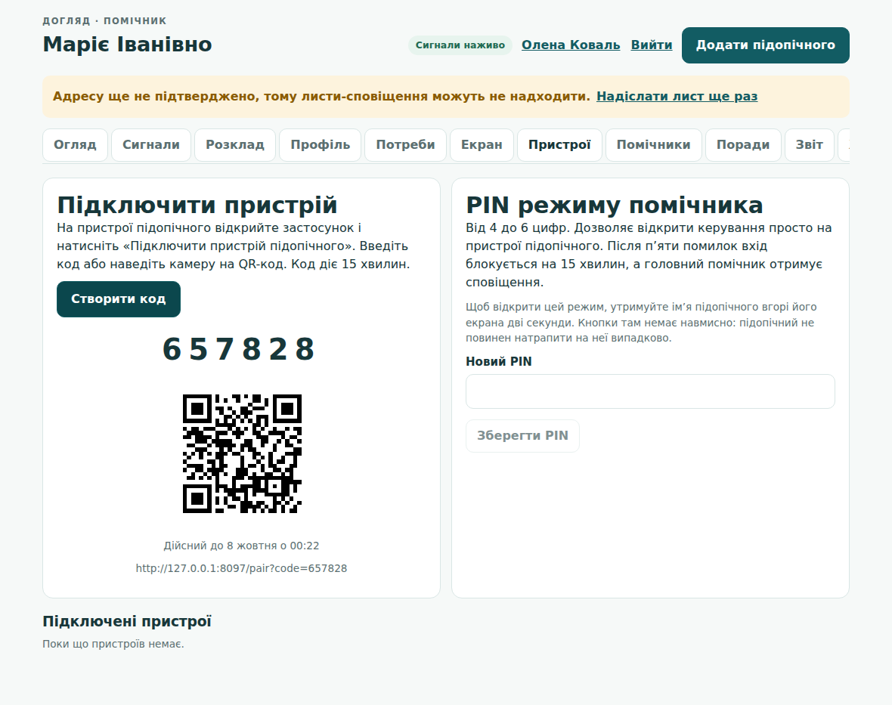
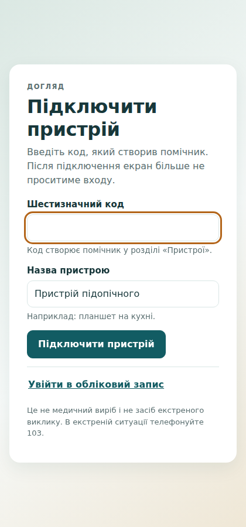

# Догляд

«Догляд» — PWA для щоденних справ підопічного та роботи його помічників. Підопічний не має облікового запису: помічник підключає пристрій одноразовим кодом або QR-кодом, після чого пристрій відкриває лише простий екран поточної справи.

> Це не медичний виріб і не засіб екстреного виклику. В екстреній ситуації телефонуйте 103.

## Що вміє застосунок

**Помічник**

- облікові записи з підтвердженням пошти, відновленням пароля, захистом від перебору та CSRF;
- профілі підопічних, права доступу, роль головного помічника, запрошення поштою або посиланням;
- завдання: щодня, у вибрані дні тижня, кожні N днів або один раз; кроки виконання, пояснення, фото ліків, вікна нагадувань і ескалації;
- **живі сигнали**: «Потрібна допомога», «Я не пам'ятаю» та ескалації з'являються в панелі одразу, зі звуком і системним сповіщенням — не лише в пошті;
- профіль функціональних потреб, налаштування екрана підопічного з живим попереднім переглядом;
- поради на основі знеособлених спостережень: застосовуються лише після згоди помічника;
- звіт із часткою вчасних виконань і експортом у CSV, журнал дій;
- канали сповіщень з тихими годинами: Web Push, Telegram, пошта;
- **режим помічника за PIN** просто на пристрої підопічного: відмітити справу й закрити сигнал, не дістаючи власний телефон. Налаштування доступу, пристроїв і профілю звідти не відкриваються — планшет лишається в чужій квартирі.

**Підопічний**

- одна поточна справа великим текстом, кроки та фото;
- велика кнопка виконання, скасування помилкового натискання, «Я не пам'ятаю» із захистом від повторного приймання ліків;
- «Потрібна допомога» однією кнопкою та номер телефону на екрані;
- доступність: масштаб до 200%, три палітри, великі кнопки, шрифт для дислексії, інтервали тексту, екранна лупа з панорамуванням, озвучення;
- офлайн: відмітки зберігаються на пристрої та надсилаються, коли з'явиться зв'язок; екран не гасне під час справи.

Навіщо застосунок існує, для кого він і за якими числами перевіряти, чи він працює —
описано в [docs/doslidzhennya.md](docs/doslidzhennya.md).

## Як це виглядає

### Два екрани одного застосунку

Ліворуч — панель помічника, праворуч — екран підопічного в ту саму мить.
Підопічний натиснув «Потрібна допомога»: банер у помічника з'явився сам,
без перезавантаження сторінки.

<table>
  <tr>
    <td width="68%"></td>
    <td width="32%"></td>
  </tr>
</table>

### Адаптація екрана за анкетою потреб

Помічник відповідає на побутові питання — «важко читати звичайний текст?»,
«важко влучати в невеликі кнопки?» — і екран підопічного змінюється сам.
Діагнози застосунок не збирає.

<table>
  <tr>
    <td width="50%" align="center"><b>До анкети</b></td>
    <td width="50%" align="center"><b>Після анкети</b></td>
  </tr>
  <tr>
    <td align="center"></td>
    <td align="center"></td>
  </tr>
</table>

Помічник одразу бачить, що саме змінилося і через яку відповідь:



### Підключення пристрою

Підопічний не реєструється й не вводить паролів: помічник створює код,
підопічний вводить шість цифр або наводить камеру на QR — і більше ніколи
не входить у застосунок.

<table>
  <tr>
    <td width="68%"></td>
    <td width="32%"></td>
  </tr>
</table>

### Решта сценаріїв

У [`docs/screens/`](docs/screens/) зібрано одинадцять сценаріїв користування. У кожному —
пара «до / після», причому обидва екрани зняті одночасно:

| Сценарій | Зведений лист |
| --- | --- |
| Створення профілю підопічного | [01](docs/screens/01-stvorennya-profilyu/zvedennya.png) |
| Додавання щоденної справи | [02](docs/screens/02-dodavannya-spravy/zvedennya.png) |
| Підключення пристрою | [03](docs/screens/03-pidkluchennya-prystroyu/zvedennya.png) |
| Адаптація за анкетою потреб | [04](docs/screens/04-anketa-potreb/zvedennya.png) |
| Відмітка виконання | [05](docs/screens/05-vidmitka-vykonannya/zvedennya.png) |
| Скасування помилкового натискання | [06](docs/screens/06-skasuvannya-vidmitky/zvedennya.png) |
| Сигнал «Потрібна допомога» | [07](docs/screens/07-potribna-dopomoga/zvedennya.png) |
| Закриття сигналу помічником | [08](docs/screens/08-zakryttya-sygnalu/zvedennya.png) |
| «Я не пам'ятаю»: питання і відповідь | [09](docs/screens/09-ya-ne-pamyatayu/zvedennya.png) |
| Звіт із показниками роботи | [10](docs/screens/10-zvit-pokaznyky/zvedennya.png) |
| Режим помічника на пристрої підопічного | [11](docs/screens/11-rezhym-pomichnyka/zvedennya.png) |

Знімки створюються автоматично, не руками: `web/e2e/scenarios.spec.ts` проходить
сценарії через інтерфейс, `web/e2e/contact-sheets.mjs` збирає зведені листи
та галерею `docs/screens/index.html`.

## Що потрібно

Go 1.24+ та Node.js 20+. PostgreSQL і Docker не потрібні: застосунок сам створює файл SQLite.

## Швидкий запуск

Одна команда збирає інтерфейс, збирає сервер і запускає його:

```powershell
.\start.ps1 -Demo
```

```bash
./start.sh --demo
```

Без `-Demo` (або `--demo`) застосунок запускається з порожньою базою. Застосунок
відкриється на `http://127.0.0.1:8080`; сервер сам роздає і статику, і API.

## Запуск для розробки

Відкрийте два термінали.

Перший — сервер із демонстраційними даними:

```powershell
cd backend
go run ./cmd/seed
$env:DATABASE_PATH='./data/demo.db'
go run ./cmd/api
```

Сидер створює окремий файл `backend/data/demo.db` і не змінює робочу базу `doglyad.db`.

Другий — інтерфейс:

```powershell
cd web
npm install
npm run dev
```

Відкрийте адресу, яку покаже Vite, зазвичай `http://127.0.0.1:5173`.

### Демонстраційний вхід

| Поле | Значення |
| --- | --- |
| Електронна пошта | `olena.demo@doglyad.local` |
| Пароль | `DemoCare2026!` |

Другий помічник для перевірки прав: `petro.demo@doglyad.local` із тим самим паролем. Дані призначені лише для локальної демонстрації.

## Змінні середовища

Створіть приватний файл за прикладом `.env.example`.

| Змінна | Призначення |
| --- | --- |
| `ADDR` | Адреса сервера, типово `:8080` |
| `DATABASE_PATH` | Файл SQLite, типово `./data/doglyad.db` |
| `MEDIA_DIR` | Каталог фотографій |
| `WEB_DIR` | Каталог зібраного інтерфейсу, який роздає сервер |
| `WEB_ORIGIN` | Адреса Vite для CORS під час розробки |
| `PUBLIC_URL` | Публічний домен для посилань у листах і QR-кодах |
| `COOKIE_SECURE` | `false` локально, `true` за HTTPS |
| `VAPID_PUBLIC_KEY`, `VAPID_PRIVATE_KEY`, `VAPID_SUBJECT` | Ключі Web Push |
| `TELEGRAM_BOT_TOKEN`, `TELEGRAM_BOT_NAME` | Бот для сповіщень |
| `SMTP_HOST`, `SMTP_PORT`, `SMTP_USERNAME`, `SMTP_PASSWORD`, `SMTP_FROM`, `SMTP_STARTTLS` | Поштовий сервер |

Якщо канал не налаштований, сервер попереджає про це під час запуску, а повідомлення цього каналу друкуються в журнал. Так зручно розробляти, але для робочого сервера налаштуйте всі три канали.

### Ключі Web Push

```powershell
cd backend
go run ./cmd/keys
```

Команда виведе `VAPID_PUBLIC_KEY` і `VAPID_PRIVATE_KEY`. Приватний ключ зберігайте лише на сервері.

### Telegram

1. Створіть бота через `@BotFather`, отримайте токен.
2. Додайте `TELEGRAM_BOT_TOKEN` і `TELEGRAM_BOT_NAME` до файла середовища.
3. У застосунку відкрийте «Профіль» → «Підключити Telegram» і натисніть у боті «Почати».

## Перевірка

```powershell
cd backend
go test ./...
go vet ./...

cd ../web
npm run check
npm run build
```

Наскрізна перевірка у браузері — проти запущеного застосунку:

```powershell
cd web
npx playwright install chromium   # один раз
npm run e2e
```

Тест сам створює помічника, підопічного, завдання та пристрій, тож демонстраційні
дані для нього не потрібні. Окремо перевіряються сім портретів підопічних
(`e2e/portraits.spec.ts`): розмір тексту, палітра, контраст і розмір кнопок для
кожного набору функціональних потреб.

Знімки сценаріїв «до / після» з обох екранів одночасно збираються командами:

```powershell
cd web
npx playwright test scenarios
node e2e/contact-sheets.mjs
```

Результат — `docs/screens/` із галереєю `index.html`. Якщо застосунок працює не на типовому порту, вкажіть
адресу: `$env:E2E_BASE_URL='http://127.0.0.1:9000'`.

## Розгортання

1. Зберіть інтерфейс: `cd web; npm ci; npm run build`.
2. Зберіть сервер: `cd ../backend; go build -o doglyad ./cmd/api; go build -o doglyad-keys ./cmd/keys`.
3. Скопіюйте на сервер:
   - бінарники — у `/opt/doglyad/`;
   - вміст `web/dist` — у `/opt/doglyad/web/`;
   - `deploy/doglyad.service` — у `/etc/systemd/system/`;
   - `deploy/doglyad.env.example` — у `/etc/doglyad/doglyad.env` та заповніть значення.
4. Створіть користувача й каталог даних:

   ```bash
   sudo useradd --system --home /var/lib/doglyad --shell /usr/sbin/nologin doglyad
   sudo mkdir -p /var/lib/doglyad/media
   sudo chown -R doglyad:doglyad /var/lib/doglyad
   sudo chmod 640 /etc/doglyad/doglyad.env
   sudo chown root:doglyad /etc/doglyad/doglyad.env
   ```

5. Увімкніть службу: `sudo systemctl daemon-reload`, `sudo systemctl enable --now doglyad`, `sudo systemctl status doglyad`.
6. Налаштуйте Caddy за прикладом `deploy/Caddyfile`, замінивши домен. Сервер сам роздає і статику, і API, тому проксі потрібен лише для HTTPS.
7. У робочому середовищі обов'язково `COOKIE_SECURE=true`.

### Резервні копії

Щодня копіюйте базу та медіа:

```bash
sudo -u doglyad sqlite3 /var/lib/doglyad/doglyad.db "VACUUM INTO '/var/lib/doglyad/backup-$(date +%F).db'"
sudo tar -czf /var/backups/doglyad-media-$(date +%F).tar.gz -C /var/lib/doglyad media
```

Копії зберігайте поза сервером. Файл бази містить персональні дані підопічних.

## Структура

```text
backend/cmd/api/          Запуск сервера
backend/cmd/seed/         Генератор демонстраційних даних
backend/cmd/keys/         Створення ключів Web Push
backend/internal/api/     HTTP-інтерфейс, планувальник, черга доставки
backend/internal/notify/  Web Push, Telegram, пошта
backend/internal/store/   SQLite та схема бази
web/src/auth/             Вхід, реєстрація, підключення пристрою
web/src/helper/           Розділи помічника
web/src/ward/             Екран підопічного
web/public/               Маніфест, іконки, service worker
deploy/                   systemd, Caddy, приклад файла середовища
```

## Приватність

- Діагнози не збираються. Профіль потреб описує лише те, що впливає на показ екрана.
- Сигнали адаптації — це лічильники подій за добу, без тексту й без часу конкретних дій.
- Токени сесій, пристроїв, запрошень і кодів зберігаються у вигляді хешів.
- Журнал дій показує, хто і коли змінював налаштування; він доступний головному помічникові.
